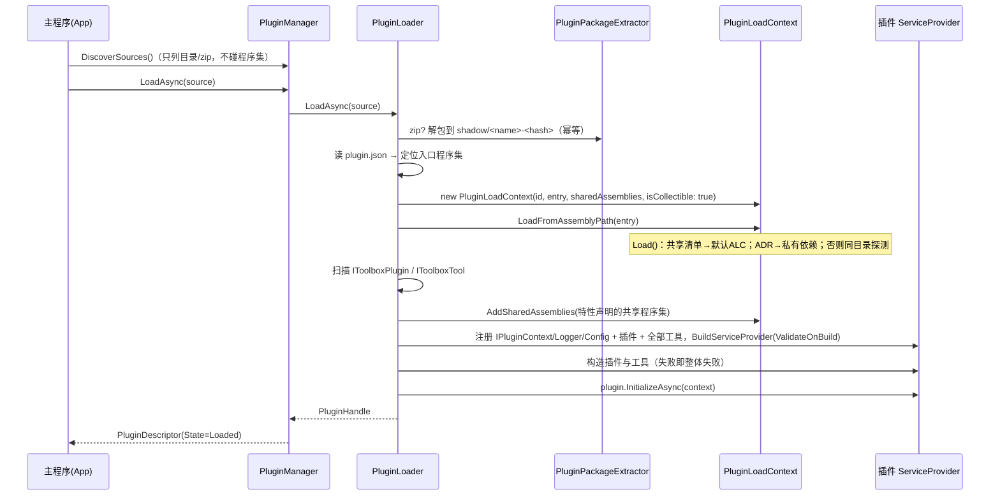
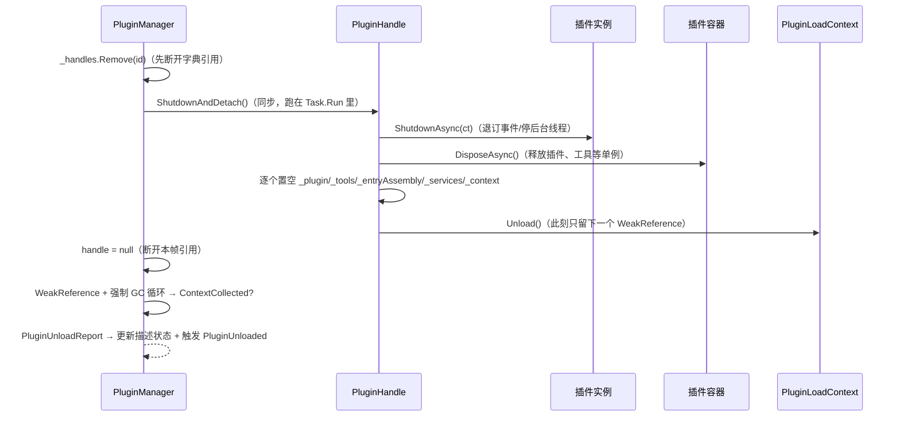

# Toolbox 插件化工具箱 · 设计说明

> 目标框架 **.NET 10**（实测 SDK `10.0.401`，运行时 `10.0.12`），语言 **C# 14**。
> 主程序负责 UI / 插件管理 / 配置 / 日志；契约层零依赖；PluginHost 用
> `AssemblyLoadContext` + `AssemblyDependencyResolver` 从 `plugins/` 动态加载
> dll / 文件夹 / zip；DI 用 `Microsoft.Extensions.DependencyInjection`。

---

## 1. 分层与依赖方向

```
┌──────────────────────────────────────────────────────────────┐
│ Toolbox.App（主程序，WPF）                                    │
│   UI · 组合根(DI) · 配置(appsettings.json) · 日志(文件+UI)     │
└───────────────┬──────────────────────────────┬───────────────┘
                │ 引用                          │ 引用
                ▼                              ▼
┌───────────────────────────────┐   ┌──────────────────────────┐
│ Toolbox.PluginHost            │──▶│ Toolbox.Contracts（零依赖）│
│  PluginLoadContext            │   │  IToolboxPlugin           │
│  PluginLoader / PluginManager │   │  IPluginContext/Logger/…  │
│  只依赖 DI 与日志的抽象         │   └──────────────────────────┘
└───────────────────────────────┘               ▲
                                                │ Private="false"（不复制 dll）
                                    ┌───────────┴───────────────┐
                                    │ plugins/*（插件工程）       │
                                    │ 只引用 Contracts            │
                                    └───────────────────────────┘
```

| 工程 | TFM | 依赖 | 职责 |
| --- | --- | --- | --- |
| [Toolbox.Contracts](../src/Toolbox.Contracts/Toolbox.Contracts.csproj) | `net10.0` | **无（只用 BCL）** | 插件/工具接口、上下文、日志与配置抽象、元数据特性 |
| [Toolbox.PluginHost](../src/Toolbox.PluginHost/Toolbox.PluginHost.csproj) | `net10.0` | Contracts + `DI` + `Logging.Abstractions` | ALC 隔离、依赖解析、zip 影子解包、插件级 DI、卸载与回收验证 |
| [Toolbox.App](../src/Toolbox.App/Toolbox.App.csproj) | `net10.0-windows` | Host + `DI`/`Logging`/`Configuration` 实现 | WPF UI、组合根、配置、文件与 UI 日志 |
| [plugins/*](../plugins) | `net10.0` / `net10.0-windows` | 仅 Contracts（私有依赖除外） | `Toolbox.Plugin.SysInfo`（初始测试插件：系统环境检测，带跨 ALC 界面）+ 其私有依赖 `Toolbox.Plugin.SysInfo.Core` |
| [tests/…SmokeTest](../tests/Toolbox.PluginHost.SmokeTest) | `net10.0` | Host + DI + Logging | 80 项端到端断言（加载/隔离/DI/配置/卸载回收/文件锁/跨 ALC UI） |

**依赖方向铁律**：插件 → 契约；宿主 → 契约；插件**不能**引用 `Toolbox.PluginHost` / `Toolbox.App`。
一旦反向引用，宿主类型必须跨 ALC 共享，隔离和卸载都会变得不可控。

---

## 2. 关键接口（契约层，零依赖）

```csharp
// 插件入口：用特性携带元数据，避免"为了列表而实例化插件"
[ToolboxPlugin("sysinfo", DisplayName = "系统环境检测", Version = "1.0.0",
               SharedAssemblies = ["Acme.Domain"])]
public sealed class SysInfoPlugin : IToolboxPlugin
{
    public ValueTask InitializeAsync(IPluginContext context, CancellationToken ct = default);
    public ValueTask ShutdownAsync(CancellationToken ct = default);
}

// 宿主交给插件的唯一环境入口：DI 用 BCL 的 IServiceProvider，日志/配置用自己的抽象
public interface IPluginContext
{
    string PluginId { get; }
    string PluginDirectory { get; }   // 目录插件=原目录；zip=只读影子目录
    string DataDirectory { get; }     // 插件私有可写目录
    IServiceProvider Services { get; }         // 插件私有容器
    IPluginLogger Logger { get; }
    IPluginConfiguration Configuration { get; }
}

// 工具：插件里真正干活的最小单元，由宿主反射发现并注册进插件容器
public interface IToolboxTool
{
    string Name { get; }
    string? Description { get; }
    ValueTask<ToolResult> ExecuteAsync(
        IReadOnlyDictionary<string, string?> arguments,
        CancellationToken cancellationToken = default);
}

public readonly record struct ToolResult(bool Success, string? Output, string? Error);
public interface IPluginLogger { bool IsEnabled(PluginLogLevel level); void Log(PluginLogLevel, string, Exception? = null); }
public interface IPluginConfiguration { string? Get(string key); bool TryGet(string, out string?); IReadOnlyDictionary<string, string?> GetAll(); }
```

**为什么契约层零依赖**：`IPluginContext.Services` 用 BCL 的 `IServiceProvider`，日志/配置用自己的小接口，
宿主再用适配器（`PluginLoggerAdapter` / `PluginConfigurationAdapter`）把它们接到
`Microsoft.Extensions.Logging` 与主程序配置上。这样插件的编译期依赖 = 契约 + BCL，
宿主换日志框架、换配置源都不需要重新编译插件，也不会出现"插件自带一份
`Microsoft.Extensions.Logging.Abstractions` 与宿主版本打架"的问题。

**宿主侧对外 API**（主程序只跟这几个类型打交道）：

| 类型 | 用途 |
| --- | --- |
| `PluginManager` | 目录刷新、`LoadAsync` / `LoadAllAsync` / `UnloadAsync` / `ReloadAsync`、`InvokeToolAsync`、`CleanupShadowCopies`、`DescriptorChanged` / `PluginUnloaded` 事件 |
| `PluginLoader` | 单插件加载：实体化 → 定位入口 → 建 ALC → 扫描 → 组装插件 DI → 初始化 |
| `PluginLoadContext` | 可回收 ALC：共享清单 / ADR 解析 / 原生库解析 |
| `PluginDescriptor` | **纯字符串投影**（Id/名称/版本/状态/工具名/ALC 内程序集名/错误），UI 只绑定它 |
| `PluginHandle` | 插件"活体"：ALC + 程序集 + 插件实例 + 工具 + 插件 DI 容器；**用完即弃** |
| `PluginUnloadReport` | 卸载结果：`WasLoaded` / `ContextCollected` / `CollectionAttempts` / `Elapsed` / `Error` |
| `IPluginSettingsProvider` | 主程序侧配置注入点（宿主不认识 `IConfiguration`） |
| `AddToolboxPluginHost()` | 组合根一行注册（C# 14 extension members 实现） |

---

## 3. 加载时序



卸载时序（顺序不可颠倒，详见 §6）：



---

## 4. PluginLoadContext：解析顺序决定一切

```csharp
protected override Assembly? Load(AssemblyName assemblyName)
{
    // 1) 共享程序集（Toolbox.Contracts 等）：返回 null → 交给默认 ALC
    //    ★ 类型同一性的唯一保障：插件里的 IToolboxPlugin 必须就是宿主看到的那个类型
    if (_sharedAssemblies.Contains(name)) return null;

    // 2) 插件私有依赖：严格按插件自己的 *.deps.json 解析（版本/satellite 都在里面）
    var resolved = _resolver.ResolveAssemblyToPath(assemblyName);
    if (resolved is not null) return LoadFromAssemblyPath(resolved);

    // 3) 兜底：同目录同名 dll（没有 deps.json 的简单插件）
    var probe = Path.Combine(PluginDirectory, name + ".dll");
    if (File.Exists(probe)) return LoadFromAssemblyPath(probe);

    // 4) 都不命中：返回 null，让默认 ALC 处理框架程序集
    return null;
}
```

要点与陷阱：

1. **`AssemblyDependencyResolver` 必须用入口 dll 的绝对路径构造**，它在同目录找 `*.deps.json`；
   没带 deps.json 时它不报错，只是什么都解析不出来（所以有第 3 步兜底）。
2. **返回 `null` ≠ "找不到"**，而是"交给默认 ALC"。共享逻辑正是靠这个语义实现的，不要写成抛异常。
3. **共享清单要包含 `Toolbox.Contracts`**（`PluginHostOptions.SharedAssemblies` 默认已含）。
   插件工程必须 `Private="false" ExcludeAssets="runtime"` 引用契约，绝不把 `Toolbox.Contracts.dll`
   复制进插件目录——否则插件 ALC 里会加载第二份，跨 ALC 传 `IToolboxPlugin` 会
   `InvalidCastException` / `MissingMethodException`，而且是运行时才炸。
4. **清单里没写、特性里写了** `SharedAssemblies` 的情况，用 `AddSharedAssemblies()` 在入口程序集加载后立刻补进去
   （必须在依赖它的程序集被加载之前，所以这是"紧随其后"的一次性机会）。
5. **原生库**：`ResolveUnmanagedDllToPath` 命中就用，否则探测
   `runtimes/<rid>/native/<name>[.dll]`；`IntPtr.Zero` 表示交回宿主进程。
6. **ALC 不是沙箱**：加载即完全信任。要权限隔离就另起进程（受限账户/作业对象），别指望 ALC。
7. `isCollectible: true` 才可能回收；默认 ALC 调 `Unload()` 会直接抛 `InvalidOperationException`。
8. ALC 名称只是诊断标签（本骨架用来源名命名，因为真正的插件 Id 要读完成特性才知道）。

---

## 5. 三种来源形态怎么变成"可加载的目录"

| 形态 | 处理 | 入口定位 |
| --- | --- | --- |
| 文件夹 `plugins/<Name>/` | 就地加载（开发期最方便） | `plugin.json.entryAssembly` → `<目录名>.dll` → 唯一的 dll |
| zip `plugins/<Name>-<ver>.zip` | 解包到 `plugins/.shadow/<包名>-<内容哈希前12>`（有 `.extracted` 标记则复用） | 同上（**zip 里只要不止一个 dll，就必须有 `plugin.json`**） |
| 多 dll / 嵌套结构 | 同上 | 必须靠 `plugin.json` 的 `entryAssembly` |

**为什么 zip 要先解包到磁盘**：
`AssemblyDependencyResolver` 需要真实的入口 dll 路径；satellite 与 `runtimes/<rid>/native` 也必须有落盘的相对路径。
按内容哈希命名带来三个好处：同版本重复安装幂等、不同版本天然隔离、升级/回滚互不覆盖。

解包器还做了两件安全/健壮性的事：zip-slip 路径越界校验（拒绝 `../` 逃逸）、
跳过 `__MACOSX` / `.DS_Store` 噪音。

**影子目录清理**：`PluginManager.CleanupShadowCopies()` 删掉"当前没有加载"的影子目录。
删不掉说明 Windows 上还有文件锁 → 也就是还没真正卸载（这正是最好的自检信号）；下次启动再试即可。

---

## 6. DI：宿主容器与插件容器是两个世界

```csharp
// 插件私有容器（PluginLoader.BuildPluginServices）
services.AddSingleton<IPluginLogger>(pluginLogger);
services.AddSingleton<IPluginConfiguration>(configuration);
services.AddSingleton<IPluginContext>(pluginContext);
services.AddSingleton(pluginEntryType);                        // 插件实例
foreach (var toolType in toolTypes)
    services.AddSingleton(typeof(IToolboxTool), toolType);     // 全部工具
var provider = services.BuildServiceProvider(new ServiceProviderOptions {
    ValidateOnBuild = true,   // 构造不出工具 → 加载阶段就失败，而不是等用户点执行
    ValidateScopes = true,
});
```

| 规则 | 原因 |
| --- | --- |
| 插件类型**只**注册进插件容器 | 注册进宿主容器 = 宿主单例持有插件类型 → 永远无法卸载 |
| 插件容器随插件卸载 `DisposeAsync()` | 插件实例、工具等单例在这里释放；同步 `Dispose()` 遇到"只实现 `IAsyncDisposable` 的单例"会抛异常 |
| 工具用构造注入拿服务（示例：`EchoTool(IPluginLogger)`） | 插件内部依赖由插件自己的容器解决，宿主不参与 |
| `IPluginContext.Services` 后绑定（`AttachServices`） | 容器里注册了 `IPluginContext` 自身，存在构造环 |
| 宿主给插件的能力只有"上下文 + 日志 + 只读配置 + 数据目录" | 能力面越小，卸载时越没有残留引用 |

配置合并优先级：**`plugin.json` 的 `settings`（默认值）< 主程序 `PluginHost:Plugins:<id>`（覆盖）**。
宿主只认 `IPluginSettingsProvider`，主程序用 `ConfigurationPluginSettingsProvider` 适配 `IConfiguration`——
PluginHost 因此不需要引用任何配置包。

---

## 7. 卸载：协议、验证与注意事项

### 7.1 卸载协议（本骨架的核心不变量）

```
① 从 _handles 字典摘除         → 切断"集合"这条强引用
② 同步 Teardown（Task.Run 内）  → 插件 ShutdownAsync → 插件容器 DisposeAsync → 逐个置空句柄字段 → ALC.Unload()
③ handle = null                → 切断"本次调用"这条强引用（async 状态机字段也要清）
④ WeakReference + 强制 GC 循环  → WeakReference.IsAlive == false 才算真回收
```

三条经验性结论（本仓库实测）：

* **同步 Teardown 是关键**。如果卸载路径写成 `await handle.ShutdownAsync()` 并在同一个 async 方法里继续验证，
  已完成的状态机会把插件实例/程序集留在堆上，验证永远失败。
  本骨架的做法：等待异步清理用**显式阻塞**（`ValueTask.AsTask().GetAwaiter().GetResult()`），
  整个 Teardown 放 `Task.Run` 的**同步**方法里，返回时只带走一个 `WeakReference`。
* **验证循环本身要够狠**：`GC.Collect(2, Forced, blocking: true, compacting: true)` + `GC.WaitForPendingFinalizers()`
  再 Collect 一次，循环 N 轮（默认 8 轮）中间 `Sleep`。
* **实测结果**：Debug 与 Release 下示例插件均在 **1 轮 GC** 内回收；回收后影子目录可立即删除（文件锁已释放）。

### 7.2 卸载注意事项清单

**A. 必须做到**

1. ALC 必须 `isCollectible: true`；卸载前必须先让插件 `ShutdownAsync` 完成清理。
2. 释放插件 DI 容器（`ServiceProvider.DisposeAsync`）必须在 `ALC.Unload()` **之前**。
3. 宿主侧所有强引用都要断：字典移除、句柄字段置空、UI/缓存不保留插件对象。
4. 用 `WeakReference` + 强制 GC 循环验证，把结果（`ContextCollected`）暴露给 UI/日志，不要"假装卸载成功"。
5. 卸载在 UI 线程之外执行（GC 循环会阻塞几十~几百毫秒）。
6. Windows 上文件锁就是"未回收"的证据：回收后再删影子目录，删不掉就要查引用。
7. 重新加载同一个插件前，先确保上一次的 ALC 已回收（`ReloadAsync` 内部就是"卸载并验证回收 → 再加载"）。
   否则同一路径的程序集可能被复用/文件仍被占用。
8. 契约程序集必须共享（插件不复制 `Toolbox.Contracts.dll`），共享清单只放"确实需要类型同一性"的程序集。
9. UI 侧：卸载请求发出后要把插件视图**同步**摘出视觉树（本骨架的 `PluginToolViewHost.Release`），
   而且必须发生在 `ALC.Unload()` **之前**。用 `Dispatcher.BeginInvoke` 之类的"稍后再摘"，
   会让回收验证时好时坏（`PluginUnloading` 事件就是为这个同步窗口设计的）。

**B. 绝不要做（会钉住 ALC）**

1. 把插件类型/实例/`Assembly` 放进宿主 DI 单例、静态字段、`ConcurrentDictionary` 缓存。
2. 在默认 ALC 里缓存插件的 `Type`：`Expression.Compile()` 缓存、`dynamic`/DLR 调用点、
   `JsonSerializer` 泛型缓存、`TypeDescriptor`、`Enum`/`Regex` 缓存、泛型静态字段……
   这些都活在默认 ALC，一旦键是插件类型就永不释放。
3. 插件订阅宿主长生命周期事件却在 `ShutdownAsync` 里忘记退订（宿主→插件的委托是强引用）。
4. 插件起 `Timer` / `Thread` / 长跑 `Task` 而不响应取消（或用了 `Task.Run` 且没有取消路径）。
5. 插件把 WPF 对象（`DependencyProperty`、`DataTemplate`、资源字典、绑定源、控件类型）塞进
   `Application.Current.Resources` 或任何 App 级缓存——WPF 的类型/属性系统缓存基本不可清理，
   **插件界面应"纯 C# 构建 + 自带颜色"，主题只管宿主自己的调色板**
   （切主题不会、也不应该去改插件视图的颜色）。
6. 插件在 `AssemblyLoadContext.Default` 上注册 `Resolving` / `AppDomain.AssemblyResolve` 等全局钩子。
7. 插件用 `Assembly.LoadFrom` / `Assembly.Load(byte[])` 之外的方式把程序集加载进默认上下文
   （等于绕过隔离，顺便把依赖也污染进默认 ALC）。
8. 宿主与插件之间用 `dynamic`、`InternalsVisibleTo`、匿名类型序列化等"隐式跨 ALC"手段。
9. 插件引用宿主实现程序集（`Toolbox.PluginHost` / `Toolbox.App`），迫使宿主类型共享。
10. 把卸载当成"秒级热更新"：卸载是**协作式、弱保证**的，只保证"请求 + 通常能回收"，
    不保证时序；频繁重载会带来多代 GC 抖动。
11. 给"插件视图"或它的**任何祖先容器**挂 WPF 动画 / `Effect` / 常驻 `VisualState`：
    动画时钟由 WPF 计时管理器持有，它会钉住目标元素 —— 挂在插件视图上就等于把插件对象钉在计时器上。
    动效只做**宿主自己的外观元素**（工具栏图标、列表容器、标题栏），本骨架的主题文件里写死了这条纪律。
12. 插件视图类派生 `DependencyObject`（`UserControl` / `FrameworkElement` 子类）：
    实例化之后 WPF 的类型 / DP 元数据缓存会记住这个插件 `Type`，ALC 就收不回来了。
    正确姿势是"**插件定义的类不派生 WPF 类型**"：把框架控件（`Grid` / `TextBox`…）作为字段组合进去，
    再用 `IPluginViewLifetime.View` 把内层框架元素交给宿主挂载。
13. 用 BAML/XAML 定义插件界面（`pack://application:,,,/插件程序集;component/…`）：
    这个 URI 的资源解析指向**宿主**，跨 ALC 必然失败。插件界面请用纯 C# 构建。
14. 对**共享调色板刷子**（`SolidColorBrush` 资源）做 `ColorAnimation` 或直接改 `Color`：
    WPF 把塞进 Style/模板的 Freezable 冻结后根本改不动，就算能改，动的也是全窗口共享的那一份
    （悬停一下全 UI 变色）。1.0.0-beta 起主题切换的正确姿势已写死在骨架里：
    **颜色引用一律 `DynamicResource`，切主题时整体替换调色板键对应的刷子实例；
    状态动效只做"本地图层 + `Opacity` 动画"**（`ModernTheme.xaml` 文件头有完整说明）。

**C. 常见"回收不了"的外部原因（不是代码 bug）**

* 附加了调试器 / 有 profiler / 诊断工具（`dotnet-dump`、`dotnet-counters`、`dotnet-gcdump`）持有引用。
* UI 自动化客户端（UIA）持有了插件的界面元素引用：客户端的 `AutomationElement` 代理会经
  provider 反向钉住插件对象，此时"界面已经摘掉"也不够。
  `scripts/ui-smoke.ps1` 因此在卸载前显式释放自己拿到的插件元素引用并触发一次 GC ——
  这不是给测试放水，而是"任何还活着的引用都算数"这条纪律的实例。
* 插件对象还在终结器队列里（`GC.WaitForPendingFinalizers` 之后仍未释放 → 循环多跑几轮）。
* P/Invoke 注册了 native→managed 回调且未解除。
* `AsyncLocal` / `ThreadStatic` 长期持有插件对象。
* 发布方式不兼容：`PublishTrimmed` / NativeAOT / 单文件会让反射发现与动态加载失效，
  **宿主必须以 JIT + 完整元数据发布**。

**D. 排查手段**

1. 打开 `PluginHostOptions.VerifyUnload`（默认开），看 `PluginUnloadReport` 与 `PluginUnloaded` 事件。
2. `PluginDescriptor.LoadedAssemblyNames` / `PluginLoadContext.GetLoadedAssemblyNames()`：
   确认插件 ALC 里**没有** `Toolbox.Contracts`（有的话说明契约被打包进插件了）。
3. `CleanupShadowCopies()` 删不掉影子目录 → 说明文件仍被映射 → ALC 未回收。
4. `dotnet-gcdump` / `dotnet-dump analyze` + `dumpheap -type AssemblyLoadContext` / `gcroot` 找根。
5. 在 `AssemblyLoadContext.Unloading` 处挂日志，确认卸载请求确实到达。

---

## 8. .NET 10 / C# 14 落地情况

| 特性 | 用在哪 | 状态 |
| --- | --- | --- |
| **extension members**（`extension(IServiceCollection services) { … }`） | `PluginHostServiceCollectionExtensions.AddToolboxPluginHost` | ✅ 已使用并编译通过 |
| **`field` 关键字** | `PluginHostOptions.PluginDirectory` / `UnloadVerifyAttempts`（访问器内直接校验） | ✅ 已使用并编译通过 |
| `params ReadOnlySpan<T>` / 集合表达式 | 可选优化（工具参数、诊断列表） | 未使用（避免过度设计） |
| 空条件赋值 `obj?.Prop = value` | 可简化描述对象合并 | 未使用 |
| `.slnx` 解决方案格式 | [Toolbox.slnx](../Toolbox.slnx) | ✅ 使用（`dotnet build Toolbox.slnx`） |

`global.json` 固定 `10.0.100 / latestFeature`；`Directory.Build.props` 统一
`LangVersion=14.0`、`Nullable=enable`、`TreatWarningsAsErrors=true`、`ArtifactsPath=artifacts/`；
包版本走 `Directory.Packages.props` 中央管理（`Microsoft.Extensions.*` 10.0.12）。

---

## 9. 失败模式速查

| 现象 | 首查 |
| --- | --- |
| `InvalidCastException` / `MissingMethodException`，说 `IToolboxPlugin` 不匹配 | 契约是否被复制进插件目录；`SharedAssemblies` 是否含 `Toolbox.Contracts` |
| 加载报 `FileNotFoundException: xxx` | 插件私有依赖是否在 deps.json/同目录；zip 是否漏打包依赖 |
| "插件里有多个程序集，无法确定入口" | 补 `plugin.json` 的 `entryAssembly` |
| `GetTypes()` 抛 `ReflectionTypeLoadException` | 缺依赖；日志里已打印 loader 异常（扫描会对可用类型继续） |
| 卸载后 `ContextCollected=false` | 按 §7.2 B/C 清单查引用；打开日志看是否 `Unload` 已请求 |
| 重载后拿到的是旧代码 | 上一次 ALC 还没回收就重新加载同一路径；确认 `ReloadAsync` 的验证结果 |
| `ValidateOnBuild` 报工具无法构造 | 工具的构造函数参数没在插件容器里注册（插件只能用上下文/日志/配置/自己注册的服务） |
| 影子目录删不掉 | 文件仍被映射 = 还没回收；不是清理逻辑的问题 |

---

## 10. 后续可扩展方向

* **插件依赖图与版本约束**：清单加 `dependencies` / `hostVersion`，加载前做兼容性校验。
* **权限与签名**：包签名校验、Hash 白名单；真正的权限隔离放到子进程。
* **配置写回与 UI**：`IPluginConfiguration` 目前只读，可在主程序侧加"插件设置页"与持久化。
* **工具参数模式**：给 `IToolboxTool` 加 `IReadOnlyList<ToolParameter>`，UI 自动生成表单（现在是 `key=value` 文本）。
* **可观测性**：把 `PluginUnloadReport` 导出成指标（加载耗时、回收轮数、失败率）。
* **多进程插件**：把"不可信插件"放到独立进程，用 gRPC/命名管道通信，彻底解决权限与崩溃隔离。
